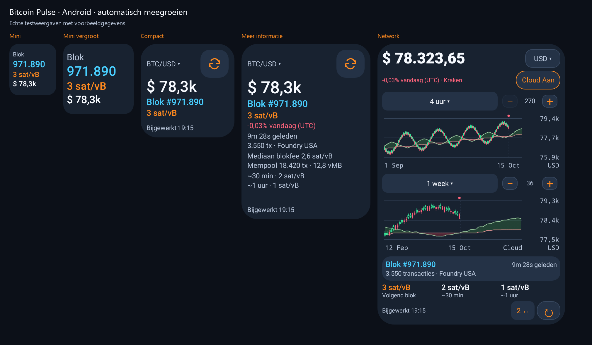
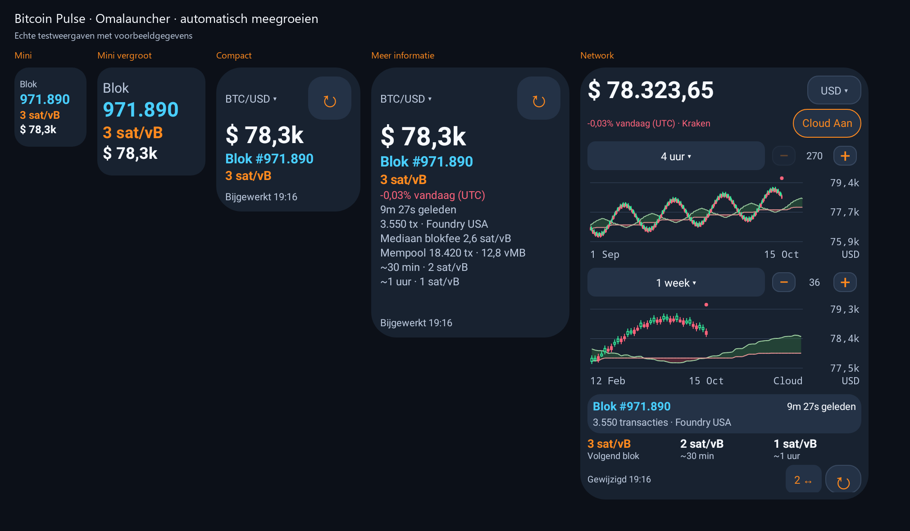

# Meegroeiende widgets — 1.8.1 / 23

Mini, compact en network zijn startformaten. Je kunt elk geplaatst exemplaar vergroten of verkleinen zonder een andere widget toe te voegen. Dit werkt in standaard Android-launchers en Omalauncher. De launcher bepaalt de celmaten en de beschikbare resizegrepen.

## Inhoud bij vergroten

| Beschikbare inhoudsruimte | Weergave |
| --- | --- |
| Kleiner dan 160 dp breed of hoog | Mini: blokhoogte, fee-advies en BTC-prijs als die past; tekst groeit mee binnen leesbare grenzen. |
| Minimaal 160×160 dp | Compact: grotere prijs, blokhoogte, fee-advies, valutakeuze, verversen en bijwerktijd. |
| Compact vanaf 220 dp hoog | Koersverandering sinds middernacht UTC. |
| Compact vanaf 240 dp hoog | Ook blokleeftijd, transacties en minerpool. |
| Compact vanaf 280 dp hoog | Ook fee-schattingen voor ongeveer 30 minuten en 1 uur. |
| Compact vanaf 300 dp hoog | Ook mediane blokfee en mempoolomvang. |
| Minimaal 250×320 dp | Network met de bestaande één/twee grafieken, cloud, intervallen, zoom en netwerkgegevens. |

De networkgrens sluit aan op de bestaande minimale breedte van de grafiekwidget. Een smalle hoge widget blijft compact en gebruikt de hoogte voor extra gegevens. De getallen zijn dp-inhoudsmaten, geen gegarandeerde celaantallen. Lange waarden passen hun tekstgrootte aan de breedte aan. Android ondersteunt daarbij ook de niet-lineaire schaal voor grotere systeemletters; Omalauncher tekent zijn eigen sans-serif-tekst.

## Testweergaven

## Behouden instellingen

Valuta, gekozen intervallen, aantal grafieken, cloud en zoom blijven bij hetzelfde widgetexemplaar. Een kleiner formaat verbergt de grafieken; het wist de keuzes of historie niet. Iedere widget heeft eigen instellingen. Grafiekbediening werkt ook wanneer het exemplaar oorspronkelijk als mini of compact is toegevoegd.

Android 12 en hoger krijgen afzonderlijke layouts voor de door de launcher gemelde exacte maten, inclusief staand/liggend. Oudere launchers gebruiken hun gerapporteerde minimale/maximale maten. Bij vergroten naar network wordt eventuele ontbrekende grafiekhistorie opnieuw opgehaald; tijdens laden blijft de widget bruikbaar.

## App en Omalauncher

De miniwidget-instellingen staan onder de compactwidget-instellingen. Het Omalauncher-onderdeel blijft onderaan en biedt network-, compact- en mini-imports. Alle drie starten met hetzelfde programma en onthouden hun eigen instellingen.

Installeer versie 1.8.1. De gewone Android-widgets krijgen het gedrag via de app-update. **Vervang eerder geïmporteerde OWL-widgets één keer met versie 5.1** via de app: Omalauncher bewaart zelfstandige kopieën. Daarna verandert het formaat direct in de launcher, zonder opnieuw importeren.

## Bronnen en onderhoud

Alle OWL-varianten komen uit app/src/main/assets/bitcoin-pulse.owl. Genereer mini/compact na wijzigingen met python tools/sync-owl-variants.py. Alleen naam, startformaat en afmetingen vóór de eerste meting verschillen. Candleverzoeken zijn alleen in de networkweergave actief; eerder opgehaalde historie blijft bewaard.

Controles gebruiken de echte Android-layouts en de officiële OWL-compiler/renderer. Testweergaven bevatten voorbeeldgegevens, geen actuele marktkoersen. Zie VALIDATION.md voor resultaten en grenzen.
