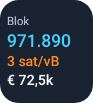

# Bitcoin Pulse · Mini 1×1

Beschikbaar vanaf Bitcoin Pulse **1.7.0 (versionCode 20)**.

Vanaf **1.8.0 (versionCode 22)** groeit de miniwidget mee naar compact en network. Ook de tekst groeit gecontroleerd mee. Verkleinen behoudt de instellingen. De miniwidget-instellingen staan onder de compactwidget-instellingen. Dit geldt voor standaard Android en Omalauncher OWL 5.0; zie [ADAPTIVE-WIDGETS.md](ADAPTIVE-WIDGETS.md).

In **1.8.1** wisselt een tik de bovenste waarde tussen blokhoogte en BTC-prijs. Het fee-advies blijft staan. Waar de tweede waarde past, wisselen beide waarden van plaats. Dit verandert de valuta niet en opent de app niet.

## Toevoegen en valuta instellen

1. Open Bitcoin Pulse → **Widgets** → **Miniwidget · 1×1**.
2. Tik op **Miniwidget toevoegen** en bevestig het toevoegen op je startscherm. Je kunt ook het widgetoverzicht van je launcher gebruiken en **Bitcoin Pulse · Mini 1×1** kiezen.
3. Ga terug naar de app. Onder **Je miniwidgets** staat elk toegevoegd exemplaar met een eigen keuze **€ EUR / $ USD**.
4. Voeg opnieuw een miniwidget toe voor een tweede exemplaar. Zo kun je tegelijk één in euro's en één in dollars tonen.

Elke nieuwe miniwidget begint in EUR. De keuze wordt lokaal per widget-ID bewaard en verandert de appvaluta of andere widgets niet. Tik op een miniwidget om blokhoogte en BTC-prijs bovenaan te wisselen; het fee-advies blijft staan. Dit blijft binnen de widget en verandert de valuta niet. Verwijderen van een miniwidget ruimt alleen de instellingen van dat exemplaar op.

## Wat wordt getoond?

- **Blokhoogte:** de volledige laatst opgehaalde Bitcoin-blokhoogte, in cyaan.
- **Fee-advies:** mempool.space's geschatte tarief voor het volgende blok, in sat/vB en oranje. Bevestigingstijden zijn schattingen.
- **BTC-prijs:** de laatst opgehaalde Kraken-prijs voor de ingestelde valuta, afgerond naar bijvoorbeeld € 73,5k of $ 79,4k. De toegankelijkheidsbeschrijving bevat de volledige prijs.

De widget vraagt één vak breed en één vak hoog. De launcher bepaalt de werkelijke afmetingen. Bij weinig ruimte of grotere systeemletters wordt de prijsregel verborgen; bij het kleinste formaat ook het label Blok. Blokhoogte en fee krijgen voorrang en passen zich aan de beschikbare breedte aan. Je kunt de widget vergroten als je launcher dat ondersteunt.

Ontbrekende gegevens verschijnen als —, nooit als een verzonnen nulwaarde. Bij mislukte of verouderde brongegevens blijft de laatst bekende waarde staan; het label meldt waar mogelijk **Blok · oud** en de toegankelijkheidsbeschrijving vermeldt de status.

## Verversen

De miniwidget deelt de bestaande gegevenscache en achtergrondtaak met de andere Android-widgets. De app vraagt bij openen en ongeveer elke 30 seconden een update; widgets vragen achtergrondupdates ongeveer elke 15 minuten. Android kan die uitstellen om de batterij te sparen. Open de app om actuele gegevens op te vragen. EUR en USD komen uit de bestaande tickerbron; er zijn geen extra accounts of toestemmingen nodig.

Vanaf **1.7.1 (versionCode 21)** is dezelfde miniwidget ook beschikbaar voor Omalauncher. Open het onderdeel **Omalauncher** onderaan het tabblad Widgets, kies EUR of USD en tik op **Miniwidget toevoegen aan Omalauncher**. Voeg elk exemplaar apart toe. Tik later op een geïmporteerde miniwidget om blokhoogte en BTC-prijs bovenaan te wisselen. De valuta blijft de vóór het toevoegen gekozen valuta; Omalauncher bewaart die instellingen zelf. Zie [OMALAUNCHER.md](OMALAUNCHER.md).

De bestaande grote en compacte widgets blijven beschikbaar; alle Omalauncher-startformaten gebruiken nu OWL 5.1. Oude geïmporteerde OWL-kopieën moeten hiervoor eenmaal worden vervangen. Wijzigingen worden voortaan voor beide launcheruitvoeringen samen uitgewerkt.

## Voorbeelden uit de Android-layout

 

[Instellingen in de app](docs/design/miniwidget-settings-native.png)

## Controle

De echte Android-layout is automatisch gecontroleerd op 40×40, 56×56, 64×64, 80×72, 80×88 en 120×120 dp, inclusief grotere systeemletters, volledige blokhoogtes, EUR/USD en ontbrekende/verouderde gegevens. Ook de echte appknoppen en onafhankelijke instellingen van twee exemplaren zijn getest. Verschillen tussen fysieke launchers moeten nog op een telefoon worden gecontroleerd.
